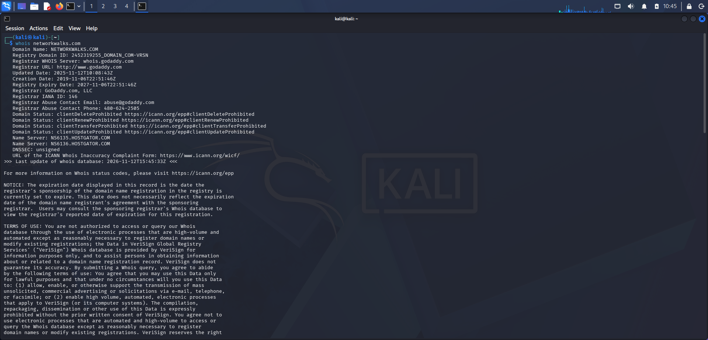
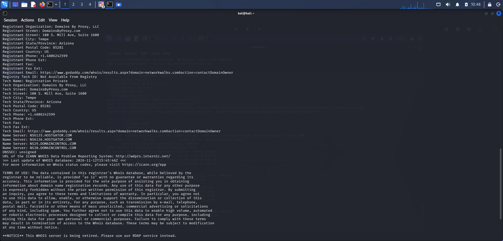
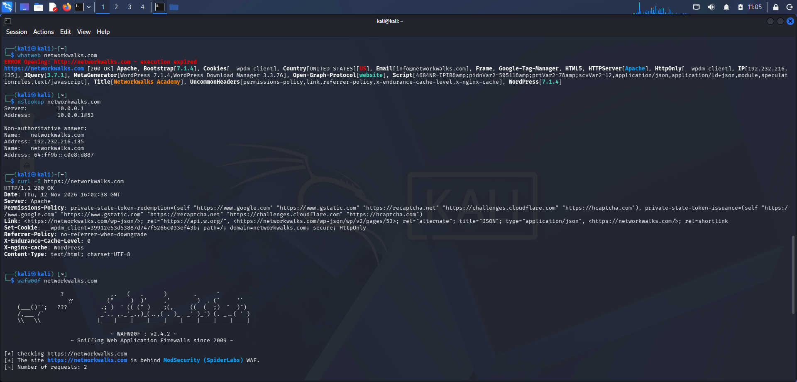
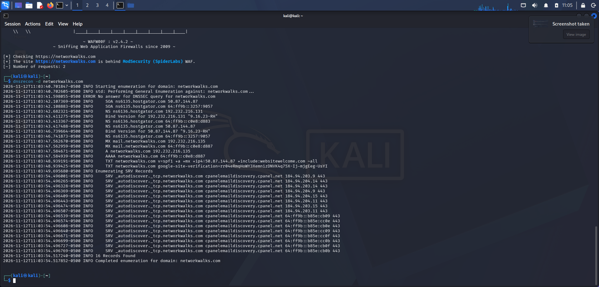
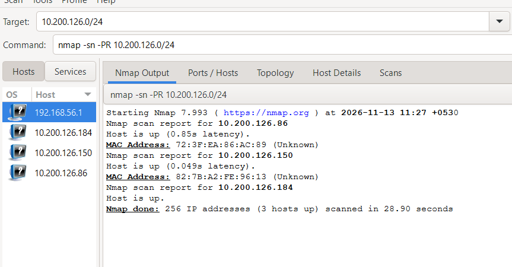
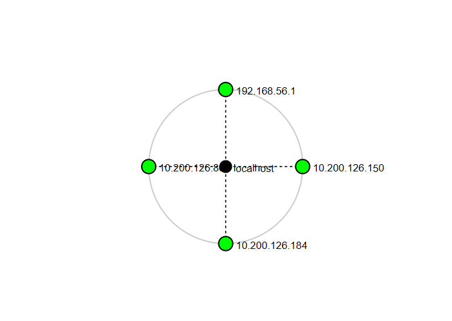

# Networkwalks-Week2-Cybersecurity-Lab

# 🔐 Penetration Testing & Network Reconnaissance Report


## 📌 Project Overview

This repository documents practical cybersecurity activities focused on **Footprinting, Reconnaissance, and Network Scanning**.

The project demonstrates how cybersecurity tools are used to collect information about websites, identify web technologies, analyze DNS records, inspect HTTP responses, detect Web Application Firewalls (WAF), and discover active devices on a network.

The practical activities were performed using Kali Linux, Windows Command Prompt, and Zenmap.

## 🎯 Objectives

- Understand the fundamentals of penetration testing.
- Perform footprinting and information gathering.
- Identify website technologies and server information.
- Analyze DNS records and HTTP response headers.
- Identify Web Application Firewall technologies.
- Discover live hosts within a local network.
- Identify IP addresses and MAC addresses of discovered devices.
- Visualize network topology using Zenmap.
- Analyze potential security risks and suggest mitigation techniques.

## 🛠️ Tools & Technologies

| Tool | Purpose |
|---|---|
| Kali Linux | Penetration testing environment |
| WHOIS | Domain registration information |
| WhatWeb | Website technology fingerprinting |
| Nslookup | DNS lookup and domain resolution |
| cURL | HTTP response header analysis |
| Wafw00f | Web Application Firewall detection |
| DNSRecon | DNS enumeration |
| Nmap | Network scanning and host discovery |
| Zenmap | Graphical interface for Nmap |
| Windows CMD | Network configuration and MAC address identification |

---

# 🔎 Project 1: Footprinting & Reconnaissance

## Overview

Footprinting and reconnaissance are initial stages of penetration testing. They involve gathering information about a target system or website to understand its publicly exposed infrastructure.

### 1. WHOIS Lookup

WHOIS is used to retrieve domain registration information.

**Information collected:**
- Domain registrar
- Domain registration details
- Expiration date
- Name servers
- Publicly available ownership information

**Command:**

```bash
whois example.com
```

**Execution Evidence:**






### 2. WhatWeb

WhatWeb is used to identify technologies and frameworks used by websites.

**Information identified:**
- Web server technologies
- Content Management Systems (CMS)
- JavaScript libraries
- Frameworks
- Website technology fingerprints

**Command:**

```bash
whatweb https://example.com
```

### 3. cURL

cURL is used to communicate with web servers and inspect HTTP response headers.

**Information identified:**
- HTTP status codes
- Server information
- Content type
- HTTP response headers

**Command:**

```bash
curl -I https://example.com
```

### 4. Wafw00f

Wafw00f is a tool used to identify whether a website is protected by a Web Application Firewall (WAF).

**Purpose:**
- Detect WAF technologies
- Identify security protection mechanisms
- Understand website security infrastructure

**Command:**

```bash
wafw00f https://example.com
```

### 5. Nslookup

Nslookup is used to resolve domain names into IP addresses and retrieve DNS information.

**Purpose:**
- Resolve domain names into IP addresses.
- Retrieve DNS records.
- Identify DNS servers associated with a domain.

**Command:**

```bash
nslookup example.com
```

### Execution Evidence – WhatWeb, cURL, Wafw00f & Nslookup

The following screenshot contains the execution outputs of all four tools: WhatWeb, cURL using the `-I` option, Wafw00f, and Nslookup.



### 6. DNSRecon

DNSRecon is used to perform DNS enumeration and gather information about domain infrastructure.

**Information collected:**
- DNS records
- Name server details
- Mail exchange records
- Host information

**Command:**

```bash
dnsrecon -d example.com
```

**Execution Evidence – DNSRecon Results**

The following screenshot shows the DNS enumeration output obtained using DNSRecon.




# 🌐 Project 5: Network Scanning Using Zenmap

## Overview

Network scanning is used to identify active devices connected to a network and understand the network structure.

Zenmap provides a graphical interface for Nmap, making it easier to perform network discovery and visualize scan results.

## Step 1: Identify Network Configuration

The Windows Command Prompt was used to identify the local network configuration.

**Command:**

```cmd
ipconfig /all
```

The following details were identified:
- IPv4 address
- Subnet mask
- Default gateway
- Network adapter information
- Physical (MAC) address

### Identified Wi-Fi Configuration

| Parameter | Value |
|---|---|
| IPv4 Address | `10.200.126.184` |
| Subnet Mask | `255.255.255.0` |
| Default Gateway | `10.200.126.150` |
| Network Range | `10.200.126.0/24` |

## Step 2: Perform Network Discovery

Zenmap was used to scan the local Wi-Fi network and identify active hosts.

**Command:**

```bash
nmap -sn -PR 10.200.126.0/24
```

### Command Explanation

| Parameter | Description |
|---|---|
| `nmap` | Network scanning tool |
| `-sn` | Host discovery without port scanning |
| `-PR` | ARP Ping for local network discovery |
| `10.200.126.0/24` | Target network range |

## Step 3: Live Host and MAC Address Identification

The scan identified three active hosts within the network.

### Scan Results

| IP Address | Host Status | MAC Address |
|---|---|---|
| `10.200.126.86` | Up | `72:3F:EA:86:AC:89` |
| `10.200.126.150` | Up | `82:7B:A2:FE:96:13` |
| `10.200.126.184` | Up | Not displayed |

**Scan Summary:**
- Total IP addresses scanned: 256
- Live hosts discovered: 3
- MAC addresses displayed: 2

### Zenmap Host Discovery Output

The following screenshot shows the live hosts discovered by Zenmap and their corresponding MAC addresses where available.



## Step 4: Network Topology Visualization

Zenmap's Topology feature was used to visualize the discovered network hosts and understand their network relationships.

The topology view helps in:
- Visualizing discovered hosts.
- Understanding network structure.
- Identifying active devices.
- Observing network connectivity.

### Zenmap Network Topology



---

# ⚠️ Risk Analysis

The reconnaissance and network discovery activities help identify information that may be useful when assessing security.

| Observation | Potential Impact | Risk Level |
|---|---|---|
| Exposed web technologies | Technology fingerprinting | Medium |
| Public DNS information | Infrastructure mapping | Low |
| Server information disclosure | Helps further reconnaissance | Low |
| Unknown active network devices | Requires device verification | Medium |

*Note: These are potential security observations and not confirmed vulnerabilities.*

# 🛡️ Security Recommendations

1. Regularly update web applications, frameworks, and plugins.
2. Review publicly exposed server information.
3. Secure DNS configurations and remove unnecessary records.
4. Configure and monitor Web Application Firewalls.
5. Monitor network devices and investigate unknown hosts.
6. Maintain updated network documentation.
7. Perform regular security assessments.
8. Use proper access controls and network segmentation.

# 📚 Key Learnings

Through these practical activities, I gained hands-on experience in:

- Understanding the fundamentals of footprinting and reconnaissance.
- Using WHOIS for domain information gathering.
- Identifying website technologies using WhatWeb.
- Analyzing HTTP response headers using cURL.
- Detecting Web Application Firewalls using Wafw00f.
- Performing DNS enumeration using Nslookup and DNSRecon.
- Understanding IP addressing and subnetting.
- Performing network discovery using Nmap and Zenmap.
- Identifying active hosts and their MAC addresses using ARP scanning.
- Visualizing network topology.
- Understanding potential security risks and mitigation techniques.

# 📝 Conclusion

This project provided practical exposure to fundamental cybersecurity and penetration testing techniques, including footprinting, reconnaissance, DNS analysis, and network scanning.

By working with Kali Linux tools, Windows CMD, Nmap, and Zenmap, I gained a better understanding of how security professionals gather information, identify active network devices, analyze exposed technologies, and assess potential security risks.

These activities strengthened my practical knowledge of cybersecurity fundamentals and ethical hacking methodologies.

---

## 👨‍💻 Author

**Arya Ghare**

**Domain:** Cybersecurity & Ethical Hacking

**Technologies:** Kali Linux | Nmap | Zenmap | WHOIS | WhatWeb | DNSRecon
